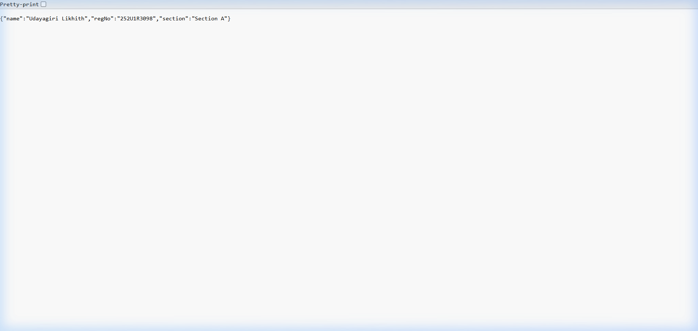
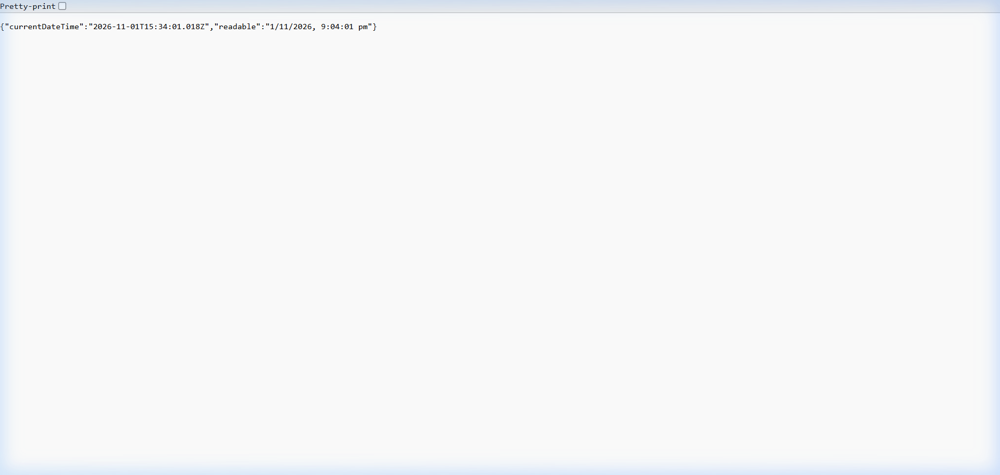
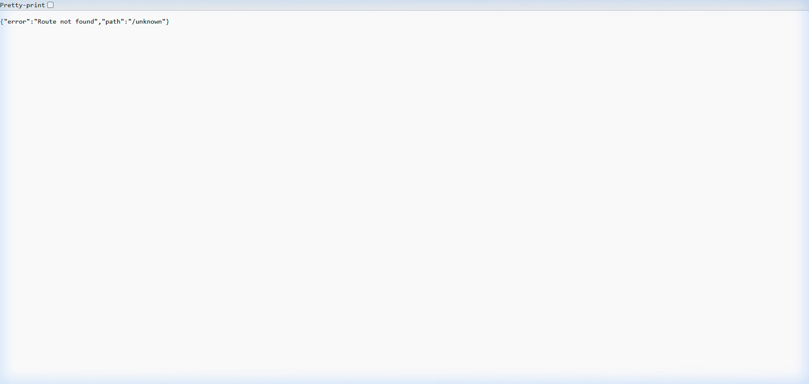

# Lab 1: Node.js and Express Server

**Live link:** *Not deployed — see Postman / browser screenshots below*

---

## Student Details

| Field              | Value              |
|--------------------|--------------------|
| **Name**           | Udayagiri Likhith  |
| **Registration No**| 252U1R3098         |
| **Section**        | A                  |
| **Course**         | Backend Development Fundamentals |
| **Faculty**        | Joel Prashanth D   |

---

## How to Run

### Prerequisites
- [Node.js](https://nodejs.org/) v18 or above installed

### Installation

```bash
# Clone or download the repository, then navigate to the lab folder
cd lab-01

# Install dependencies
npm install
```

### Environment Variables

This lab has **no required environment variables**. The port is hardcoded to `3000`.
If you wish to change it, edit `server.js` and set `const PORT = <your-port>`.

### Start the Express Server

```bash
npm start
# or
node server.js
```

The server will start at **http://localhost:3000**

### Start the Plain HTTP Server (Task 3)

```bash
npm run start:http
# or
node server-http.js
```

---

## Endpoints

| Method | Path       | Status | Description                                          |
|--------|------------|--------|------------------------------------------------------|
| GET    | `/`        | 200    | Returns a plain-text welcome message                 |
| GET    | `/about`   | 200    | Returns JSON with student name, reg no, and section  |
| GET    | `/time`    | 200    | Returns JSON with current date and time (`new Date()`)|
| GET    | `/*`       | 404    | Returns a JSON 404 error for any unknown route       |

---

## Screenshots

### GET `/` — Welcome Route (200)


### GET `/about` — About Route (200)


### GET `/time` — Time Route (200)


### GET `/unknown` — 404 Handler


---

## Package.json Fields Explained

| Field          | Meaning                                                            |
|----------------|--------------------------------------------------------------------|
| `name`         | The name of the npm package (project folder name by convention)    |
| `version`      | Semantic version of the project (starts at `1.0.0`)               |
| `description`  | A short human-readable description of the project                  |
| `main`         | The entry point file Node.js loads when the package is imported    |
| `scripts`      | Shortcut commands runnable via `npm run <name>`                    |
| `keywords`     | Tags to help others discover the package on npm                    |
| `author`       | Name (and optionally email/url) of the project creator             |
| `license`      | The software license (ISC = a permissive open-source license)      |
| `dependencies` | External packages required to **run** the project                  |

---

## Viva Questions

**Q: What is the difference between `package.json` and `node_modules`?**  
`package.json` is a manifest file that lists the project's metadata and its dependency names/versions.  
`node_modules` is the actual folder where npm downloads and stores those dependency packages on disk.  
You share `package.json` (via Git) but **never** commit `node_modules`.

**Q: What does `app.listen` do?**  
It binds the Express application to a specific TCP port and starts listening for incoming HTTP requests.  
The callback fires once the server is ready to accept connections.

**Q: What do `request` and `response` represent?**  
`request` (req) is an object representing the incoming HTTP request — it contains the URL, method, headers, query parameters, and body.  
`response` (res) is an object used to build and send the HTTP response back to the client — you use it to set status codes, headers, and the response body.

---

## Notes — Problems Faced

| Problem | Solution |
|---------|----------|
| Needed two separate server files (http vs. express) | Created `server-http.js` for the plain http module demo and `server.js` for the Express server |
| 404 handler must be registered last | Placed `app.use(...)` catch-all **after** all named routes so Express only reaches it when no route matches |
| `node_modules` would inflate repo size | Added `.gitignore` excluding `node_modules/` and `.env` from the start |
